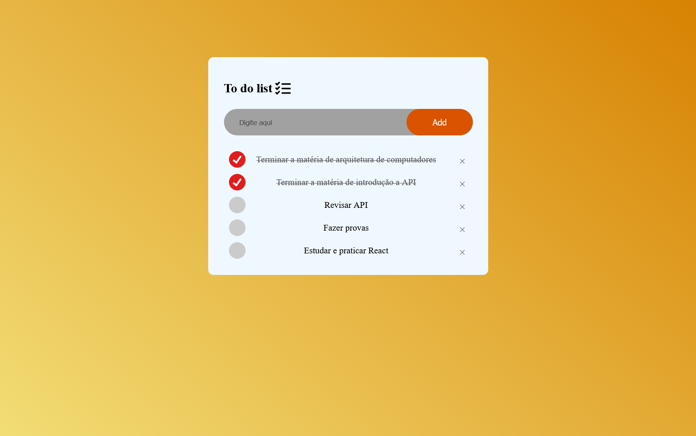

# To-Do List 

Projeto inspirado de: [https://youtu.be/G0jO8kUrg-I?si=sjH6DNMxrZTai7YQ](https://youtu.be/G0jO8kUrg-I?si=sjH6DNMxrZTai7YQ)

## Descrição

O objetivo desse projeto era estudar javascript, aprofundar o estudo nessa linguagem e conhecer novas funções, como a função localStorage que salva as anotações na memória do navegador. 
O projeto foi desenvolvido com foco primário em telas desktop/notebooks, priorizando o estudo da lógica em JavaScript.

## Ideias Futuras
Caso eu decida voltar a mexer neste projeto no futuro, essas são algumas ideias que penso em adicionar:

- [ ] - Melhorar a responsividade para o modelo "mobile first" (tecnicamente não tem);

- [ ] - Comentar o que cada comando faz de forma concisa;

- [ ] - Adicionar com a tecla "Enter" (Escutar o evento de teclado (keydown ou keypress) no input para disparar a função de adicionar quando a tecla Enter for pressionada.)

- [ ] - Contador de Tarefas Pendentes

